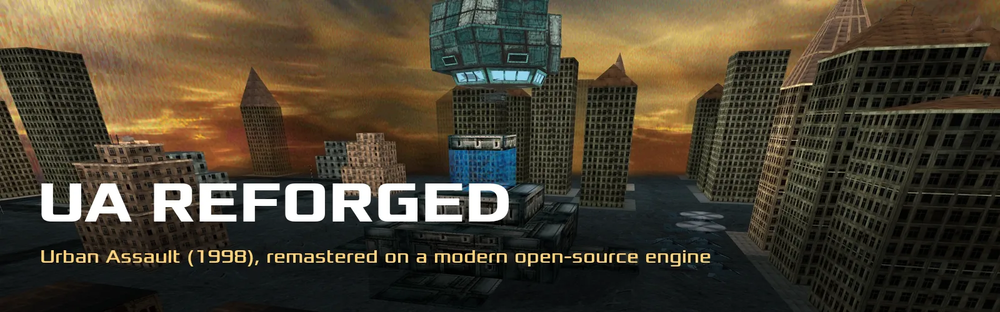
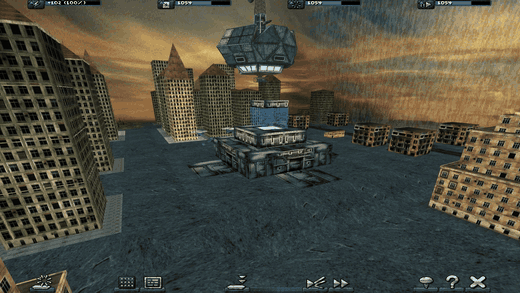
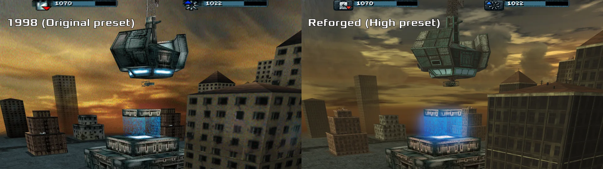
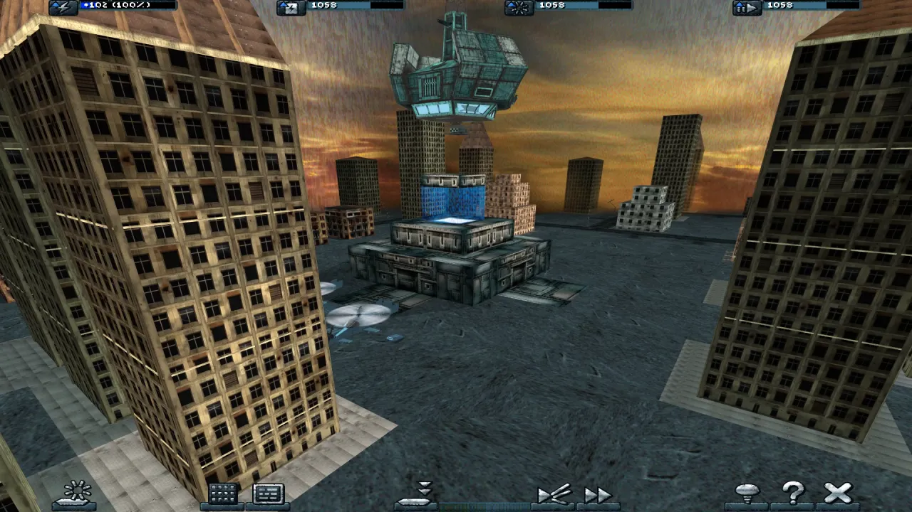
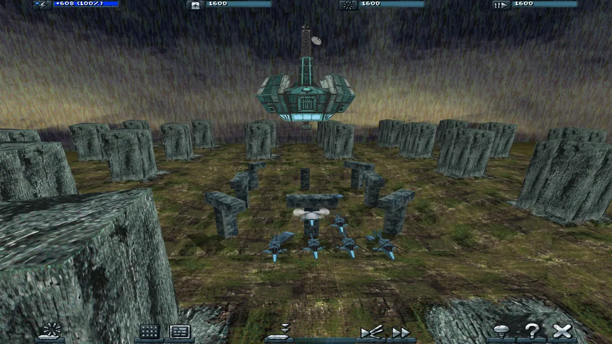

<p align="center">
  
</p>

<p align="center">
  <a href="https://github.com/ameliaaura/uareforged/releases"></a>
  <a href="https://github.com/ameliaaura/uareforged/releases"></a>
  
  <a href="LICENSE"></a>
  <a href="https://github.com/ameliaaura/uareforged/actions/workflows/build.yml"></a>
</p>

<p align="center">
  <b>Urban Assault (1998), remastered.</b> The original game on a modern open-source engine, with a new renderer,<br>
  rebuilt units and a VR Command Deck. Free, non-commercial, and you bring your own copy of the game.
</p>

<p align="center">
  <a href="https://uareforged.pages.dev/downloads/"><b>Download</b></a> ·
  <a href="docs/INSTALL.md">Install guide</a> ·
  <a href="#faq">FAQ</a> ·
  <a href="https://github.com/ameliaaura/uareforged/discussions">Discussions</a> ·
  <a href="https://github.com/ameliaaura/uareforged/issues">Issues</a> ·
  <a href="https://uareforged.pages.dev">Website</a>
</p>

<p align="center">
  
</p>

## 1998 vs Reforged

The same moment in the same level, from the same camera. Left: the **Original** preset, exactly as the game
looked in 1998. Right: **High** with the Reforge pack: the rebuilt host station, 3D clouds, glow on the beam gate,
shadows and the remastered city.



## Play in 3 steps

UA Reforged needs the original game files (`DATA` and `LEVELS`). The app fetches the free community OpenUA
Standalone Package for you, straight from the Metropolis Dawn community's own server; already have the game?
Choose its folder instead. We never host or ship Microsoft's game files.

| | macOS | Windows | Meta Quest 3 |
|---|---|---|---|
| **1** | [Download](https://uareforged.pages.dev/downloads/#install-h) the zip, drag *UA Reforged* to Applications | [Download](https://uareforged.pages.dev/downloads/#install-win-h) and run the installer | Turn on [Developer Mode](https://uareforged.pages.dev/downloads/#quest-devmode-h) and plug the headset into your Mac or PC |
| **2** | First open: *System Settings > Privacy & Security >* **Open Anyway** (needs an admin password) | SmartScreen: **More info > Run anyway** | Start UA Reforged on the computer and click **[Install on my Quest](https://uareforged.pages.dev/downloads/#quest-computer-h)** |
| **3** | Click **Set up everything** (the game + the Reforge pack in one step), then **Play** | Click **Set up everything** (the game + the Reforge pack in one step), then **Play** | In the headset: *Unknown Sources > UA Reforged VR*, then **Get the game** and the pack |
| ▶ | [Step by step](docs/INSTALL.md#macos) | [Step by step](docs/INSTALL.md#windows) | [Step by step](docs/INSTALL.md#meta-quest-3) |

Full steps, troubleshooting and uninstalling: **[docs/INSTALL.md](docs/INSTALL.md)**.

## Features

- **Reforged renderer**: sun shadows, glow, unit trails, battle marks, remastered skies with 3D clouds, per-level
  light and haze, lit windows at night and a detailed floor. Drawn by the engine, no pack needed.
- **Graphics presets**: Original, Low, Medium, High and Ultra in *Options > Graphics*. **Original is the 1998
  game, unchanged.** A short benchmark on first launch picks one for you.
- **The Reforge pack**: rebuilt units and host stations, buildings, skies, HD
  textures, restored videos, sharp menus and the floor. Same sizes and fire points, so gameplay is untouched.
  One click on first launch; every part is checked against its SHA-256.
- **UA Reforged VR** for the Meta Quest 3: play from the cockpit, or command from the **VR Command Deck**, the
  live battlefield as a table-top miniature in your room, then dive into any unit. New Look / Original switch,
  90 Hz.
- **Install on my Quest**: plug your headset into your Mac or PC and the desktop app installs or updates the VR
  app, and can copy your game files across.
- **One-step first launch**: *Set up everything* fetches the game and the Reforge pack in one progress window,
  with resumable downloads, size and checksum checks, and plain-language help when a link breaks. Your game folder
  is only read, never changed, and no dialog shows a file path.
- **Sharp UI text**, DualSense and other game controllers, and the Metropolis Dawn campaigns (Ghorkov,
  Taerkasten) with the expansion data.

<p align="center">
  
  
</p>

## System requirements

| | Minimum | Notes |
|---|---|---|
| **macOS** | Apple Silicon (M1 or later), macOS 11 | Not notarised: *Privacy & Security > Open Anyway* once (admin password). Intel Macs not supported |
| **Windows** | Windows 10 1803+ or 11, 64-bit, OpenGL 4.1 GPU | Installs per user, no admin rights |
| **Meta Quest** | Quest 3 | Quest 3S should work (untested). Sideloaded with Developer Mode |
| **Disk** | the game: 445 MB download, 675 MB on disk; the Reforge pack: 1.6 GB download, 2.4 GB on disk | The Quest downloads its own pack (712 MB). All sizes: [SIZES.md](docs/SIZES.md) |
| **Game files** | fetched by *Set up everything*, or your own *Urban Assault* | See [GAME-DATA.md](docs/GAME-DATA.md) |

## FAQ

<details><summary><b>Is this an official Microsoft project?</b></summary>

No. It is an unofficial, non-commercial fan project. Urban Assault and its designs belong to Microsoft. The engine
underneath is OpenUA, an open-source re-implementation by Marisa-Chan and contributors.
</details>

<details><summary><b>Is it free?</b></summary>

Yes. Nothing is sold, and nothing will be. Fan projects under Microsoft's Game Content Usage Rules have to stay
non-commercial, and we're happy with that.
</details>

<details><summary><b>Do I need the original game?</b></summary>

Yes. Use your own retail CD install, or the community OpenUA Standalone Package (the full game plus the
Metropolis Dawn add-on, unmodified original files, ready for the OpenUA engine), which the app can fetch for you.
The game files are Microsoft's and are hosted by the Metropolis Dawn community, not by us; we never host or ship
them. See the site's [I don't have the game](https://uareforged.pages.dev/downloads/#nogame-h).
</details>

<details><summary><b>Can I play it exactly like 1998?</b></summary>

Yes: that's the **Original** preset. On the Quest, *Settings > LOOK > Original*.
</details>

<details><summary><b>Does it change the gameplay?</b></summary>

No. The remastered models swap in at the same size and fire points, and the units, levels and factions are the
1998 game's.
</details>

<details><summary><b>Does it include Metropolis Dawn?</b></summary>

The engine runs the Metropolis Dawn campaigns (Ghorkov and Taerkasten), and the Reforge pack includes remastered
Metropolis Dawn units. You need the expansion data yourself; the community package includes it.
</details>

<details><summary><b>Why isn't the VR app in the Meta Horizon Store?</b></summary>

It is a free fan project, so you install it yourself with Developer Mode, which Meta offers to everyone. The
desktop app's *Install on my Quest* does the hard part for you.
</details>

<details><summary><b>Linux? Intel Macs? Quest 2?</b></summary>

Not supported in this release. The engine has upstream Linux build rules but they are untested with the Reforged
changes. Help testing is welcome: post in [Discussions](https://github.com/ameliaaura/uareforged/discussions).
</details>

<details><summary><b>Can I play online?</b></summary>

Between friends over a private network, yes. It can't cross-play with the original 1998 Windows game, and there
are no public servers.
</details>

More on the site's [FAQ](https://uareforged.pages.dev/faq/).

## Privacy

The apps send nothing about you. **Anonymous usage stats are optional and off unless you say yes**: the first start
asks once ("Help make UA Reforged better?", nothing pre-selected; closing it means no), and *Options* has
**Send anonymous usage stats** on the desktop (*Options*, the button under the settings text) and in VR
(*Pause > Settings > CONTROLS, PRIVACY*). Turning it off stops sending at once and deletes the app's random
install number, its unsent queue and any crash file.

When they are on, the app sends small messages to `https://uareforged.pages.dev/api/ping`:

| When | What |
|---|---|
| Every message | a random install number made on your device (128 random bits, never from your hardware; a new one each time you turn stats on), desktop or VR, Mac / Windows / Quest, the app version, the graphics preset |
| App start | the operating system name and version (`macOS 15.2`, `Windows 11 23H2`) and the graphics chip's name (`Apple M2`, `NVIDIA GeForce RTX 3070`) |
| Mission start | the level number |
| Mission end | a performance summary: level, render resolution, average fps, 1 % low fps, 95th-percentile frame time, seconds played, frames over 100 ms, the headset's display rate in VR |
| Next start after a crash | crash type (signal / exception code), app build, the program module's base name and code offsets (up to 32, e.g. `UA_source+0x1a2f40`), level, preset, minutes played |
| A problem | one code from a fixed list (e.g. `pack_download_failed`, `shader_load_failed`), sometimes one number |

**Never sent:** your name or any account, your IP address (the site doesn't store it), hardware IDs or serial
numbers, device or user names, file paths or file names from your disk, memory contents, saves, anything you
typed, your location. No cookies, a fixed `User-Agent: UA-Reforged`. The exact format and every limit:
[docs/usage-stats.md](docs/usage-stats.md); what the site keeps and for how long:
[uareforged.pages.dev/privacy](https://uareforged.pages.dev/privacy/#usage-stats).

## Build from source

```sh
packaging/macos/build-mac.sh              # macOS app + zip          docs/BUILD-macOS.md
packaging/windows/build-windows.sh        # Windows installer + zip  docs/BUILD-Windows.md (cross-built on a Mac)
packaging/quest/build-quest.sh            # Quest APK                docs/BUILD-quest.md
```

A map of the code: [docs/ARCHITECTURE.md](docs/ARCHITECTURE.md). How releases are made:
[docs/RELEASING.md](docs/RELEASING.md). What changed: [CHANGELOG.md](CHANGELOG.md).

## Contributing

Contributions are welcome: bug reports, testing on hardware we don't have, docs, and code. Small fixes can go
straight to a pull request; for bigger features, please open an issue first. Every commit needs a DCO sign-off
(`git commit -s`), and **Microsoft game files or anything made from them never go into this repository**.
Read [CONTRIBUTING.md](CONTRIBUTING.md) and the [Code of Conduct](CODE_OF_CONDUCT.md).

- Questions and ideas: [Discussions](https://github.com/ameliaaura/uareforged/discussions)
- Bugs: [Issues](https://github.com/ameliaaura/uareforged/issues/new/choose)
- Security problems: [SECURITY.md](SECURITY.md) (privately, please)
- Help: [SUPPORT.md](SUPPORT.md)

## Support

UA Reforged is free and stays free. If you'd like to say thanks, you can leave an optional tip on
[Patreon](https://www.patreon.com/AmeliaAura), or in bitcoin over Lightning at `ameliaaura@coinos.io`.
A tip doesn't buy or unlock anything: every download and update is free for everyone.

## Licences

| What | Licence |
|---|---|
| **The engine** (this repository) | [GNU GPL version 2](LICENSE), inherited from OpenUA. Every binary we ship names this repository as its source |
| **The Reforge pack**, Part A: our own work (new models, skies, effects, trails, floor materials) | [CC BY-NC 4.0](https://creativecommons.org/licenses/by-nc/4.0/), credit "Amelia Aura / UA Reforged". The designs they depict stay Microsoft's |
| **The Reforge pack**, Part B: everything remade from the 1998 game (HD textures and restored videos made from the game's own, rebuilt original models, interface art, floor masks) | Not ours: free, non-commercial fan content under [Microsoft's Game Content Usage Rules](https://www.xbox.com/en-US/developers/rules) |
| **The game** | *Urban Assault* and all its content belong to Microsoft. You bring it |
| Fonts and libraries | Their own licences (OFL, IPA, zlib, BSD, LGPL, MIT …); see [CREDITS.md](CREDITS.md) |

The pack's `LICENSE.txt` lists which part every file belongs to. Nobody may sell the pack or bundle it with
anything sold. Including us.

## Credits

- **OpenUA (UA_source)** by [Marisa-Chan](https://github.com/Marisa-Chan/UA_source) and contributors: the
  engine this is built on. Full list in [CREDITS.md](CREDITS.md).
- **The Metropolis Dawn community** ([metropolisdawn.de](https://metropolisdawn.de)), who kept Urban Assault alive
  and host the OpenUA Standalone Package.
- **TerraTools and Microsoft**, who made *Urban Assault* in 1998.
- Libraries: SDL2 (with SDL_image, SDL_ttf, SDL_net), OpenAL Soft, libogg/libvorbis, FFmpeg (LGPL, decode only),
  Lua, {fmt}, any-lite, stb, the Khronos OpenXR loader, FreeType; fonts Liberation, Xolonium, Press Start 2P,
  Textar and Rajdhani.
- The Reforged changes, the pack and the VR app: Amelia Aura.

---

<p> <sub><b>Made in Cape Town, South Africa.</b></sub></p>

<sub>UA Reforged is an unofficial fan project. It is not affiliated with, endorsed, sponsored or approved by
Microsoft. UA Reforged was created under Microsoft's
"[Game Content Usage Rules](https://www.xbox.com/en-US/developers/rules)" using assets from Urban Assault, and it
is not endorsed by or affiliated with Microsoft.</sub>
